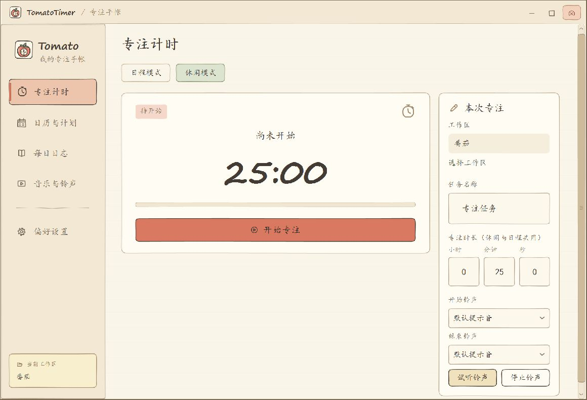
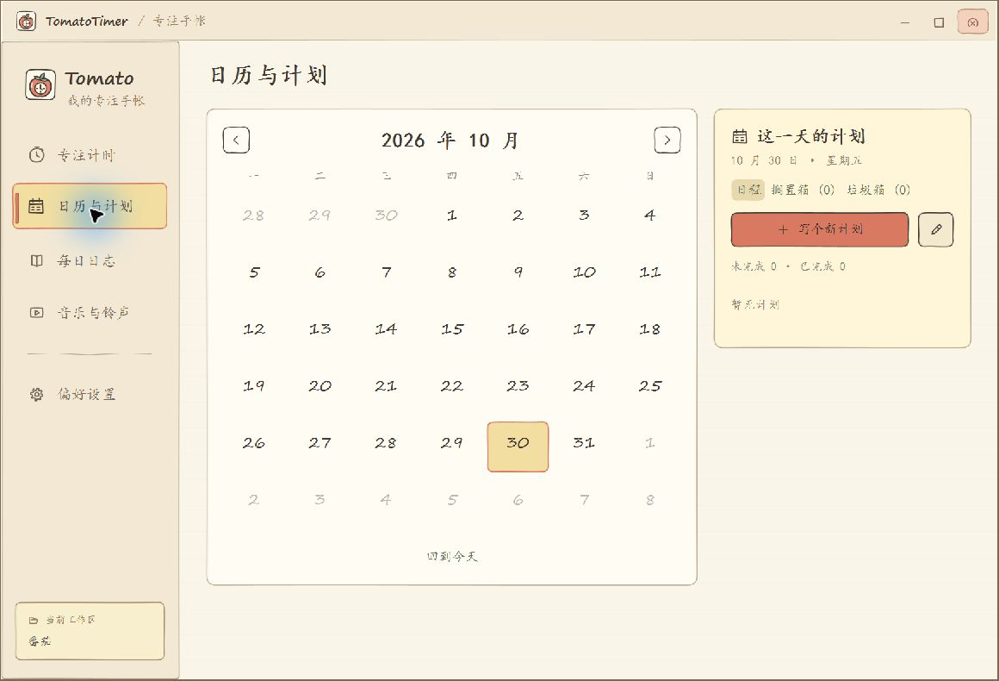
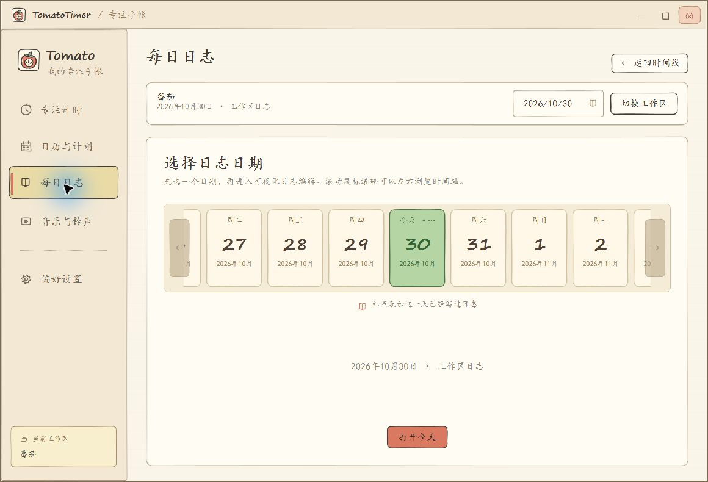
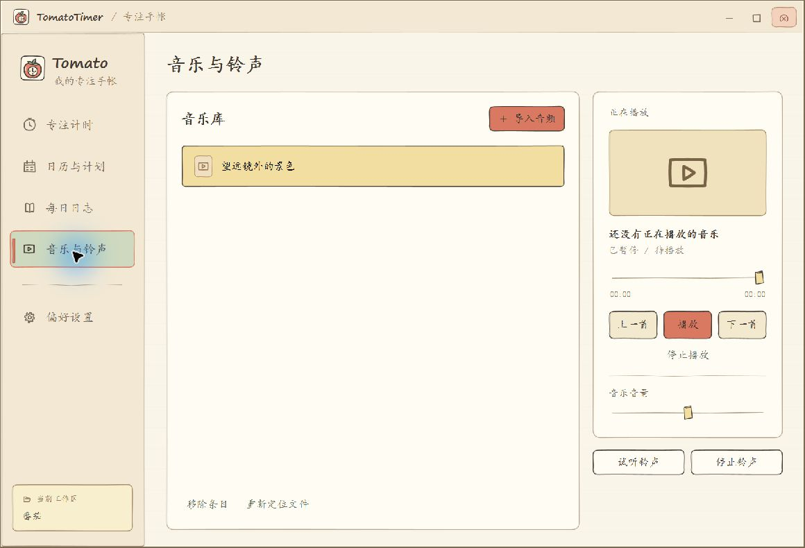

<div align="center">
  
  <h1>TomatoTimer · 我的专注手帐</h1>
  <p>安排今天的计划，专注眼前的任务，记下每一天的收获。</p>
  <p>Windows 桌面应用 · 手绘手帐风格 · 本地数据存储 · .NET 10 / WPF</p>
</div>

TomatoTimer 是一款将番茄钟、日程计划、每日日志和本地音乐放在一起的桌面软件。你可以为临时任务开启一次专注，也可以把一天的计划串成连续的番茄钟，再用日志记录过程和想法。

暖色纸张、手绘线条和手写字体贯穿整个界面，让安排时间和记录生活像翻开一本手帐。适合学习、阅读、写作、编程，以及任何需要留出一段专注时间的事情。



[功能介绍](#功能介绍) · [发布版使用说明](docs/发布版使用说明.md) · [开始使用](#开始使用) · [数据保存在哪里](#数据保存在哪里) · [开发与构建](#开发与构建)

## 功能介绍

### 专注计时，让任务有开始也有结束

- **休闲模式**：填写任务名称，设置时长，随时开始一次独立专注。
- **日程模式**：按顺序执行当天未完成且附有番茄钟的计划，展示当前任务和整体进度，并在番茄钟之间安排休息。
- **灵活调整**：通过小时、分钟、秒设置时长，默认 25 分钟；支持暂停、继续和提前结束。
- **声音提醒**：分别选择开始与结束铃声，可以先试听，也可以随时停止提醒。
- **时间分配**：在日程计时页与日历页查看计划时长的比例，以及当前工作区今日实际专注时间。暂停时间不计入专注统计。

日程模式需要先添加当天的番茄钟计划；普通待办不会自动进入计时队列。手动结束日程计时会停止自动推进。

### 日历与计划，把想做的事放进今天

在月历中选择日期，就能查看、添加和整理当天的计划。计划可以只是一个普通待办，也可以附上番茄钟和专注时长。

- 支持 **未完成、已完成、搁置、放弃** 四种状态。
- 日历标记待办与已保存的日志，方便回看一天的安排。
- 暂时不做的任务可以放进搁置箱，之后恢复到今日日程，或独立执行。
- 放弃的计划进入垃圾箱，当天仍可恢复；过期项目会在次日或后续启动时自动清理。



### 每日日志，留住专注之外的想法

日志按工作区和日期整理。先在日期时间线上选择一天，再进入编辑；即使当天没有计时记录，也可以独立书写。

- **可视化编辑与预览**：提供标题、粗体、斜体、列表、引用、链接等编辑工具，并支持预览 Markdown 效果。
- **本地 Markdown**：日志保存为 `Daily.md`，可以用其他文本编辑器打开、备份或继续整理。
- **历史回看**：通过日期时间线、历史日志或日历入口，找到过去写下的内容。
- **计时记录**：查看专注会话与统计，记录选择和每日日志相互独立。
- **编辑保护**：支持未保存内容确认、外部修改检测和恢复草稿。



### 音乐与铃声，给专注配一点背景声

导入自己的本地音频，在软件内播放、切歌、拖动进度和调整音量，也可以将音频用于计时提醒。

- 音乐和铃声音量分别设置。
- 铃声播放时，背景音乐会让位给提醒，并可按设置恢复。
- 结束铃声最多播放 30 秒，也可以手动停止。
- 音频文件移动后，可以重新定位；从音乐库移除条目不会删除原文件。

支持导入 MP3、WAV 等音频；具体格式的播放能力取决于 Windows 的解码支持。



### 悬浮时钟与托盘，让计时陪在桌面上

在偏好设置中开启悬浮时钟，可以在小窗口里查看当前任务、暂停或继续计时，也能快速返回主界面。悬浮时钟与主窗口共享同一个任务。

默认关闭主窗口后，软件会保留在系统托盘并继续运行。双击托盘图标恢复窗口，右键菜单可以暂停或继续计时、停止铃声，以及退出应用。

### 按自己的习惯设置

偏好设置支持调整默认专注时长、背景颜色、本地背景图片及其不透明度，也可以恢复默认背景。页面切换和选中反馈的动画时长、关闭窗口后的行为、音乐与提醒选项，都可以按习惯调整。

> 本页截图来自实际运行的 Windows 应用，展示默认外观下的计时、日历、日志时间线和音乐页面。

## 开始使用

### 从源码运行

需要 **Windows** 和 **.NET 10 SDK**。在仓库根目录执行：

```powershell
dotnet run --project TomatoTimerPro/TomatoTimerPro.csproj
```

也可以在 Rider 或支持 .NET 10 的 Visual Studio 中打开 `TomatoTimerPro.sln`，启动桌面项目。

### 开始第一次专注

1. **选择工作区**：选择或新建一个文件夹，用于保存该工作区的日志和专注记录。
2. **选择模式**：临时任务用「休闲模式」；需要按计划执行时，先到「日历与计划」为今天添加带番茄钟的计划，再切换到「日程模式」。
3. **开始专注**：确认任务和时长，点击「开始专注」。需要时可以暂停、继续或提前结束。
4. **写下收获**：打开「每日日志」，选择日期，记录进展和想法后保存。

想边工作边查看进度，可以到「偏好设置」开启悬浮时钟；想听背景音乐，可以先到「音乐与铃声」导入本地音频。

### 使用发布文件

在项目 **Releases** 页面，或通过 **Tags** 进入对应版本的 Release，从 **Assets** 下载作者上传的 Windows 发布包，完整解压后运行 `TomatoTimer.exe`。自动生成的 `Source code` 附件是源码归档。

如果拿到的是框架依赖发布包，需要先安装 **.NET 10 Windows Desktop Runtime**；自包含发布包自带运行时。详细下载、使用、备份和更新步骤见 [发布版使用说明](docs/发布版使用说明.md)。两种发布方式的命令见下方。

> 点击窗口关闭按钮默认会隐藏到托盘。需要完全退出，或在更新构建后重新运行时，请从托盘菜单选择「退出」。

## 数据保存在哪里

TomatoTimer 将日志、计时记录和应用配置保存在本地。工作区用于区分不同项目的日志与专注记录；每日计划由应用统一保存，独立于工作区。

| 数据 | 保存位置 |
| --- | --- |
| 每日日志 | `<工作区>/Logs/yyyy-MM-dd/Daily.md` |
| 专注会话 | `<工作区>/Logs/yyyy-MM-dd/Sessions/HHmmss_<会话ID>.json` |
| 应用设置、每日计划、音乐索引、恢复草稿 | 默认位于 `%LOCALAPPDATA%/TomatoTimer/`，可在「偏好设置 → 本地数据」中查看或修改位置 |

会话按开始日期归档；异常退出的会话按已中断处理。旧版 `%LOCALAPPDATA%/TomatoTimerPro/` 数据目录会兼容读取。

音乐和背景图片保存的是原文件路径引用，不会复制原文件。备份时，除了工作区和应用数据目录，也请保留所引用的音频和图片；修改应用数据目录不会搬动工作区日志。

## 开发与构建

项目使用 **C# / .NET 10 / WPF**，按 MMVC 分层组织，并通过 RuntimeStore 管理运行状态。

### 构建

```powershell
dotnet build TomatoTimerPro.sln -c Release
```

### 运行检查

```powershell
dotnet run --project tests/TomatoTimerPro.CoreChecks/TomatoTimerPro.CoreChecks.csproj -c Release
```

检查程序使用临时目录，覆盖计时与中断恢复、计划持久化、日志与文件冲突、音乐索引，以及 WPF 资源、绑定和窗口布局等。实际音频输出、睡眠恢复和多屏拖动等桌面行为仍需在目标设备上验证。

### 发布

框架依赖发布，目标设备需安装 .NET 10 Windows Desktop Runtime：

```powershell
dotnet publish TomatoTimerPro/TomatoTimerPro.csproj -c Release --self-contained false -o artifacts/latest
```

Windows x64 自包含发布，自带 .NET 运行时：

```powershell
dotnet publish TomatoTimerPro/TomatoTimerPro.csproj -c Release -r win-x64 --self-contained true -o artifacts/win-x64
```

### 项目结构

```text
TomatoTimerPro/
├── Bootstrap/       应用组装与依赖连接
├── Contracts/       存储、音频、交互等接口
├── Controllers/     页面与组件的交互逻辑
├── Infrastructure/  本地存储、音频和桌面能力
├── Managers/        应用、页面和悬浮时钟管理
├── Resources/       样式、图标与图片
├── RuntimeStore/    运行状态管理
├── Tools/           Markdown 与时间处理工具
└── Views/           窗口、页面、组件与对话框
tests/               核心与 WPF 检查程序
docs/screenshots/    README 界面截图
scripts/             应用图标生成等脚本
```

架构约定见 [WPF-MMVC](Rulers/WPF-MMVC.md)，产品设计背景见 [番茄钟软件需求文档](Rulers/番茄钟软件需求文档.md)。功能说明以当前实现为准。

## 图标与致谢

手绘界面图标来自 [Oreo Doodle Icons](https://github.com/oreo-design/doodle-icons)，采用 MIT 授权。选用的 SVG、[许可证](TomatoTimerPro/Resources/Icons/Doodle/LICENSE.txt)及[版本来源](TomatoTimerPro/Resources/Icons/Doodle/provenance.json)保存在 `TomatoTimerPro/Resources/Icons/Doodle/`，相关许可文件随发布包提供。

番茄应用图标为本项目原创，生成脚本见 [generate-app-icon.ps1](scripts/generate-app-icon.ps1)。
